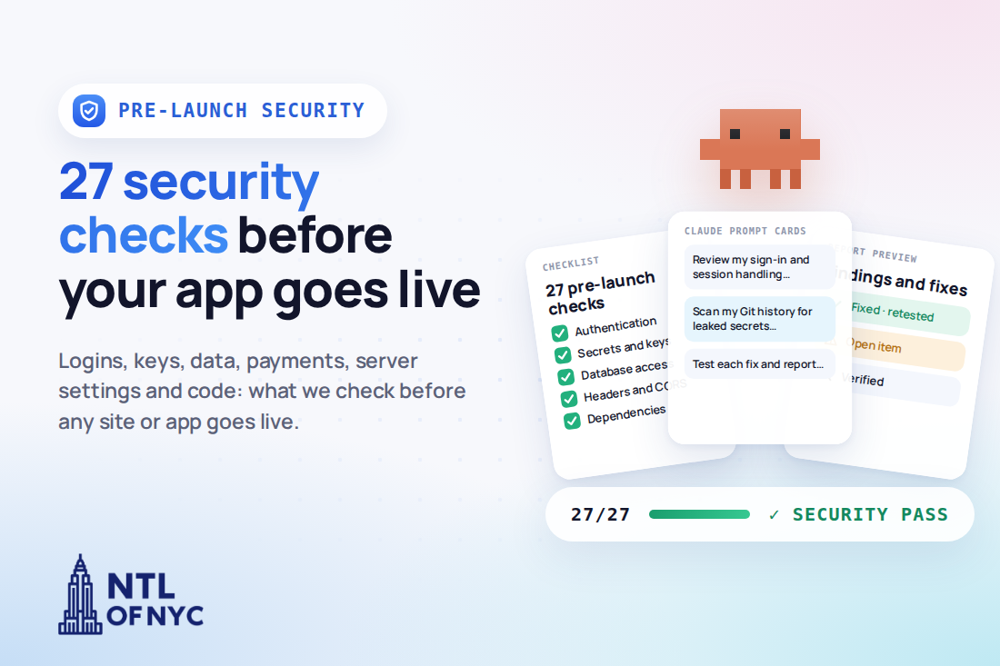
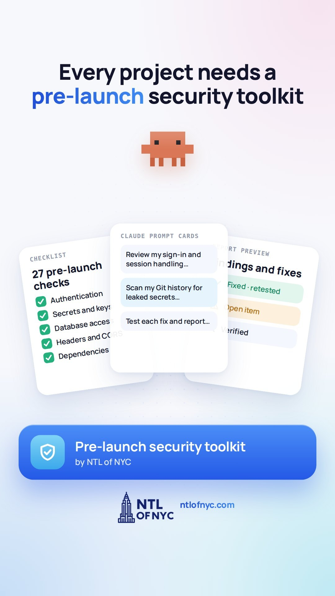

# Pre-Launch Security Checklist

**27 security checks to run before your website or app goes live, plus a drop-in skill that makes your AI coding assistant run them for you.**



Most sites and apps that get broken into aren't beaten by genius hackers. They get caught by the basics: an admin page anyone can open, an API key sitting in the browser code, a checkout that trusts whatever price the browser sends. None of that shows up when you click around your own site. It shows up after launch, when someone goes looking for it.

This is the checklist we run on every site and app we build at [NTL of NYC](https://ntlofnyc.com): 27 checks across logins, keys and secrets, data, payments, server settings and code. Each one comes with what it is, why it matters and how to test it.

## Watch: the 27 checks in 60 seconds

[](media/27-security-checks.mp4)

<sub>Tap the image to play [media/27-security-checks.mp4](media/27-security-checks.mp4) (60 s, captions in [media/27-security-checks.en.vtt](media/27-security-checks.en.vtt)). Or watch it with the full write-up on the blog: **[Pre-Launch Security Checklist: 27 Checks](https://ntlofnyc.com/blog/pre-launch-security-checklist)**.</sub>

## Quick start

**Option 1: Read and tick.** Open [CHECKLIST.md](CHECKLIST.md) and work through the 27 checks. Record results in [templates/report-template.md](templates/report-template.md).

**Option 2: Let Claude Code run it.** Install the skill, then ask in plain English:

```bash
git clone https://github.com/ntlofnyc-git/pre-launch-security-checklist.git
mkdir -p ~/.claude/skills
cp -r pre-launch-security-checklist/skill ~/.claude/skills/pre-launch-security-check
```

```text
> Run the pre-launch security check on my app
```

Claude reads your code, walks all 27 checks and writes a PASS / FAIL / N/A report with evidence, findings and fixes. It won't change code until you ask, and it re-tests each fix.

To share it with your team, copy the folder into your project instead: `.claude/skills/pre-launch-security-check/`.

**Option 3: Any other AI assistant.** Paste the prompt from [skill/PROMPT.md](skill/PROMPT.md) into Cursor, Copilot Chat, Windsurf, ChatGPT, Gemini or similar.

## The 27 checks at a glance

| Group | Checks | What it stops |
|---|---|---|
| **Logins and access** | #1 Authentication · #5 Hash passwords · #9 Lock down admin routes · #12 Rate limiting · #15 Secure session cookies · #16 CSRF protection · #17 Reset links expire | Account takeovers, open admin pages, password guessing |
| **Keys and secrets** | #2 Hide API keys · #11 Check environment variables · #24 Scan Git history · #25 Revoke and replace leaked keys | Stolen API keys and surprise bills |
| **Data and forms** | #3 Secure the database · #6 Server-side validation · #7 XSS protection · #10 Parameterized queries · #18 Restrict uploads | Database leaks, injected code, malicious uploads |
| **Payments** | #19 Verify prices and payments | Tampered prices and fake orders |
| **Server settings** | #4 Enforce HTTPS · #8 Log and monitor · #13 Restrict CORS · #14 Security headers · #20 Debug mode off · #23 Exposed files | Snooping, leaked error details, downloadable backups |
| **Code and dependencies** | #21 Update vulnerable deps · #22 Remove unused packages · #26 Full security review · #27 Test and report | Known holes in third-party code, untested fixes |

Full details, with a test for every check: **[CHECKLIST.md](CHECKLIST.md)**

## Using this with an AI coding assistant

AI assistants are good at this work when you ask for it directly. They're less reliable when you assume they did it on their own.

- **Go one check at a time.** "Review my sign-in and session handling" gets a better answer than "make it secure."
- **Ask for findings and fixes, not just fixes.** You want to know what was wrong, not only that something changed.
- **Make it prove the fix.** Ask it to test each protection, for example by trying the admin page while logged out, and show you the result.
- **Keep a human in the loop.** An AI review is a strong first pass. For anything that takes payments or stores personal data, have someone experienced check the result.

## What's in this repo

| Path | What it is |
|---|---|
| [CHECKLIST.md](CHECKLIST.md) | All 27 checks: what it is, why it matters, how to test |
| [skill/SKILL.md](skill/SKILL.md) | Claude Code skill: "run the pre-launch check on my app" |
| [skill/PROMPT.md](skill/PROMPT.md) | The same thing as a copy-paste prompt for any AI assistant |
| [templates/report-template.md](templates/report-template.md) | PASS / FAIL / N/A report with findings, fixes and sign-off |
| [media/](media/) | The 60-second video, English captions and poster |
| [images/](images/) | Cover, link card, square and portrait images for sharing |

## More from us

- **Blog post:** [Pre-Launch Security Checklist: 27 Checks](https://ntlofnyc.com/blog/pre-launch-security-checklist), the plain-English version with the video and FAQ.
- **[Secure Agent Ops](https://github.com/ntlofnyc-git/secure-agent-ops):** our field manual for running AI agents on your own servers without getting burned (server hardening, secrets, approval gates).
- **[NTL of NYC](https://ntlofnyc.com):** web design, development and AI automation. Every site and app we ship goes through this checklist before launch. Want a second pair of eyes before you go live? [Talk to us](https://ntlofnyc.com/contact).

## License

[MIT](LICENSE). Use it, copy it, adapt it for your team or your clients. A link back is appreciated.
